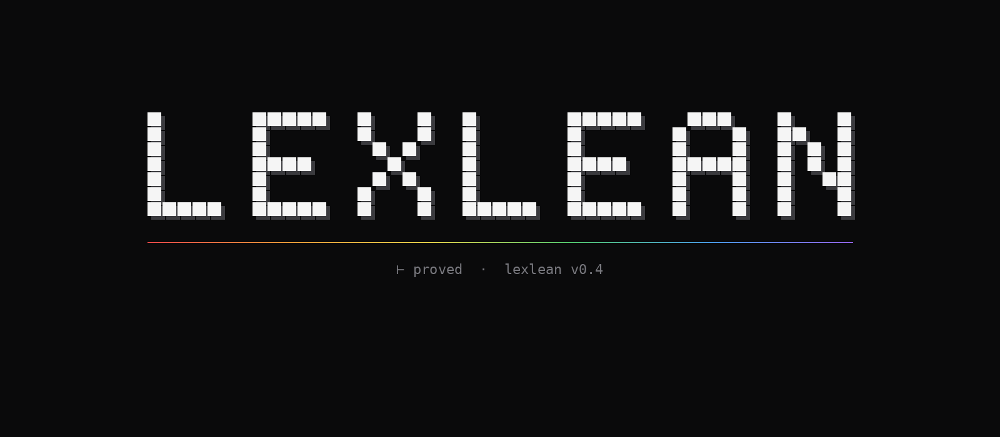

<div align="center">
  

  <p><strong>One controlled language in. A canonical paper, a kernel checked Lean 4 program, and a certified Rust package out.</strong></p>
</div>

LexLean compiles `.lex.tex` modules written in a closed controlled language. Every word, symbol, and control comes from a versioned lexicon package. Every sentence follows a fixed grammar. One typed representation produces both the canonical LaTeX document and a Lean 4 program with no prose.

`lexlean verify` compiles the generated Lean with `leanprover/lean4:v4.32.1`, replays every module with `leanchecker`, audits axioms by parsing `#print axioms` exactly, and publishes a content addressed attestation. `check` and `build` never claim verification.

[Spec](SPEC.md) · [Conformance](CONFORMANCE.md) · [Diagnostics](ERRORS.md) · [Evidence](VERIFICATION.md) · [Changelog](CHANGELOG.md) · [MNIST model](https://github.com/UOR-Foundation/MNIST)

## Quickstart

```text
docker pull ghcr.io/uor-foundation/lexlean:0.4.0
docker run --rm -v "$PWD:/work" ghcr.io/uor-foundation/lexlean:0.4.0 verify
```

The image is 4 GB because it carries the pinned toolchain. Each [release](https://github.com/UOR-Foundation/LexLean/releases) attaches one binary per supported host, the packaged crate, a CycloneDX bill of materials, checksums for every asset, and the gate evidence for the tagged commit.

```text
tar -xzf lexlean-0.4.0-binaries.tar.gz
sha256sum -c checksums.txt
```

A binary runs `init`, `lock`, `fmt`, `check`, and `build`. `verify` also needs the pinned toolchain through [elan](https://github.com/leanprover/elan). From source:

```text
cargo install --locked --path crates/lexlean
```

Then:

```text
lexlean init --name my-doc --module-prefix MyDoc
lexlean lock
lexlean check
lexlean build
lexlean verify
```

This is the complete SPEC.md §29 example, committed as [examples/nat-add-zero/src/Main.lex.tex](examples/nat-add-zero/src/Main.lex.tex):

```latex
\begin{lexlean}{Main}
\useglossary{lexlean.std.nat@1.0.0}
\title{Natural number addition}

\begin{theorem}{add-zero}
\noaxioms
For every natural number \(n\), \(n + 0 = n\).
\begin{proof}
Close the goal by reflexivity.
\end{proof}
\end{theorem}
\end{lexlean}
```

It generates a Lean module with no prose:

```lean
module
public import Init
set_option autoImplicit false
namespace LexLeanExample.Main

public theorem add_zero (llv0 : Nat) : Eq (Nat.add llv0 0) llv0 := by
  rfl

end LexLeanExample.Main
```

The same representation yields canonical LaTeX, source maps, coverage, and a manifest. Outputs are byte reproducible. `verify` checks the module, replays it with `leanchecker`, parses `#print axioms` exactly, and records the observed axiom set in a content addressed attestation.

The larger [native Atlas source graph](examples/uor-atlas/src/Atlas.lex.tex) is
rooted by `Atlas.lex.tex` and uses the generic closed-core form for lossless
formal-library migration. Its module-local typed expression DAGs, declarations,
definition bodies, proofs, inductive metadata, instances, and explicit axiom
policies are linked semantic data. The same values generate readable canonical
LaTeX and reconstruct kernel-checked Lean declarations. The one-time conversion
and exact comparison are recorded in
[MIGRATION.md](examples/uor-atlas/MIGRATION.md); the independently authored
implementation is absent from the release tree. `VR-19` permanently requires
one generated Lean module per native source module, public imports confined to
`Init` and the generated graph, only the generic `Lean` backend-support import,
and no second Atlas implementation.

Language-1.1 semantic modules use the closed-core backend's fixed finite Lean
budgets (`maxRecDepth = 100000`, `maxHeartbeats = 1000000000`) so complete
nested byte-data declarations are not restricted by interactive defaults.
Project child timeout/output limits and full kernel/axiom verification remain
mandatory. These are generated backend settings, not caller-provided options.

## Use generated Lean from Lake

For Lean tests and tactics over generated language-1.2 modules, see
[Use generated Lean from Lake](docs/LEAN-CONSUMER.md), including how to obtain
and match the `LexLeanRuntime` sources.

## Source packages

A language-1.2 project imports the modules of another project of its workspace without copying them: `[[source_package]]` in `lexlean.toml` names a member directory listed by `lexlean-workspace.toml`, `lexlean.lock` pins the package by the digest of its manifest and source files, every command recomputes the pin, imports are closed to the project's own modules and the declared packages, and `verify` replays the package's modules under its module prefix with the package as their origin (SPEC.md §10.5, `PK-01`..`PK-05`; the workspace the cases use is [tests/packages/workspace](tests/packages/workspace/)).

## Examples that verify under the pinned toolchain

The [compiler/](compiler/) project defines the production realization calculus (SPEC.md §17.14) in LexLean and passes the same gates as an example; its hand-constructed target programs live under [compiler/fixtures/](compiler/fixtures/). Its `Gnaf` module states GNAF requests over that calculus (SPEC.md §17.15): the complete-system universe, machine contract, and objective order, all fixed before any optimizer, with a kernel-checked theorem that the universe is complete. The requests themselves live under [compiler/gnaf/](compiler/gnaf/), and [compiler/gnaf.manifest.json](compiler/gnaf.manifest.json) is the dependency manifest UOR-GNAF §20 requires. Its `Certification` module checks GNAF certificates (SPEC.md §17.18) under [compiler/certificates/](compiler/certificates/): a global optimum, an argmin, or a complete Pareto frontier is certified from evidence for every system of the universe rather than by enumerating it, with the soundness of the checker proved in [compiler/proofs/](compiler/proofs/); local normality, correctness, and representation-minimality are separate, weaker statuses, and an incomplete certificate names its first open obligation. The target fixtures' Rust packages (§17.16) live under [compiler/rust/](compiler/rust/).

Every directory under [examples/](examples/) is discovered by the example gate (`EX-08`) and must format, lock, check, build, and verify with real Lean 4.32.1 (`cargo xtask verify-examples`). Its platform-independent build outputs and its normalized verification records are committed under `expected/` and compared byte for byte by the golden gate (§28.3) and the example gate (§29.5); that those bytes are also independent of where the build ran is the separate claim of `AR-13` and `EX-06`.

| Example | What it exercises |
| --- | --- |
| [nat-add-zero](examples/nat-add-zero/) | The literal SPEC.md §29 document (`EX-01`..`EX-06`). |
| [peano-arithmetic](examples/peano-arithmetic/) | Five modules with explicit imports, a local path glossary of proof constants from `Init` (`Nat.add_comm`, `Nat.le_trans`, `Eq.symm`, universe-polymorphic `rfl`, ...), label words, document-denoted definitions of all three kinds (`count`, `double`, `even`, `positive`, `divides`), noun-of and binary-noun-of frames (`the successor of`, `the sum of ... and ...`), sections with inherited parameters and references to parameterized declarations, and every §16 proof form: `Assume`, `Apply`, `Close the goal with`/`by reflexivity`, witnesses, left/right, multi-rule `rewrite` at the goal, `constructor`, `cases` on naturals and on hypotheses (`And`, `Exists`), `induction`, and `calculate`; theorems under `\noaxioms`, `\allowaxioms{propext}`, and `\exactaxioms{Classical.choice;Quot.sound;propext}` whose observed axiom sets are audited exactly. |
| [propositional-logic](examples/propositional-logic/) | Reasoning over `Prop`-typed locals with a `proposition` type noun defined as the sort: commutativity and associativity of conjunction and disjunction, disjunction elimination, double negation, De Morgan, explosion, biconditionals, and classical double-negation elimination under an exact axiom policy — through cases on `And`/`Or`/`Iff` hypotheses, `constructor`, and `Apply`. |
| [list-induction](examples/list-induction/) | Universe-polymorphic `List` with an eliminator descriptor: type-valued section parameters, `List.nil`/`List.cons`, an infix `⧺` for `List.append`, structural induction over lists using earlier document lemmas as rewrite rules, and nested noun phrases (`the length of ... equals the sum of the length of ... and the length of ...`). |
| [semantic-1.1](examples/semantic-1.1/) | A source-Lean-free, multi-module language-1.1 project covering every closed type, declaration, term, instance, structural-recursion, match, Boolean/Nat validation, proof variant, portable integer width, byte/string form, primitive operation, and cross-module kernel reduction. |
| [language-1.2](examples/language-1.2/) | The language-1.2 contract (SPEC.md §17.12): a `lexlean/semantic-module/2` module whose definition and theorem statement use the 1.2-only typed `let` term, lowered to Lean `let` and verified with an empty observed axiom set. |
| [recursive-data](examples/recursive-data/) | Language-1.2 recursive data (SPEC.md §17.12) across two modules: a self-recursive parameterized `Tree`, a nested `Rose` through `List`, the mutual `Expr`/`Stmt` group, a parameterized result-like `Outcome`, products and pairs in a structure; structural recursion and induction with one hypothesis per recursive field, under exact axiom policies. |
| [higher-order](examples/higher-order/) | Language-1.2 first-class functions (SPEC.md §17.12): generic `mapList`, `foldList`, and `compose`; lambdas with explicit captures; definition references across modules; a visitor record of functions over an arithmetic AST agreeing with direct evaluation; a generic induction theorem applied at `Nat`; executable definitions passing only non-escaping closures. |
| [recursion](examples/recursion/) | Language-1.2 recursion (SPEC.md §17.12): mutual structural groups over a nested rose tree, the mutual `Expr`/`Stmt` syntax, and the naturals, each lowered with `termination_by structural`; three well-founded normalizations (`countdown`, `reduce`, a bounded `search`) whose per-call decrease obligations are proved by `linear_arithmetic` and bound as explicit evidence; closed values computed by kernel reduction under exact axiom policies. |
| [nested-induction](examples/nested-induction/) | Language-1.2 induction over a nested inductive type (SPEC.md §17.10, §17.12): a `Json` value that holds a `List` of itself and a `List` of pairs that end in itself, mutual structural `size` and `leaves` groups over the four members of its recursive family, and `leaves_le_size` proved by `nested_induction` over the recursor the pinned Lean generates, under an exact axiom policy. |
| [collections](examples/collections/) | Language-1.2 ordered collections (SPEC.md §17.12): a String-keyed compiler symbol table built by an executable fold, a call graph whose reachability and least-first topological order the kernel computes, a cyclic graph with no order, a reasoning-state fixed point (the ancestor closure of a parent relation) reached by bounded iteration, and reordered literals that are equal by construction. |
| [production](examples/production/) | Language-1.2 production eligibility (SPEC.md §17.13): six declared roots across two modules beside formal-only theorems and a proposition-valued definition; an effect-free fixed-width root eligible on `rust-core` and `rust-std`, overflow-admitting roots over a non-recursive inductive and a non-escaping closure, a well-founded root whose termination evidence is erased, and allocation-admitting list roots eligible on `rust-std` only, including a generic dependency instantiated at `Nat`; each root's closure, effects, and dispositions are published as its eligibility report, and verification extracts the roots through Lean's compiler front end into the canonical compiler input. |
| [production-coverage](examples/production-coverage/) | Language-1.2 semantic preservation coverage (SPEC.md §17.17): 36 production roots across five modules that, with the roots of `production`, `models` and `reasoning` (the probes of `OR-02` covering the constructs no root realizes), exercise every runtime row of the production registry (§17.13) — fixed-width arithmetic at every width, text, bytes, and decimal parsing and formatting, records, options, generic and nested inductive types, higher-order functions with captures, structural, mutual, and well-founded recursion, and every collection template and key order; verification extracts every root and checks its certificate A. |
| [models](examples/models/) | Language-1.2 models (SPEC.md §17.12) across nine modules: a stateful deterministic session with an invariant, a rule policy, a statistical triage and an integer feed-forward digit recognizer whose weights are content-addressed artifacts embedded with kernel-checked decodings, stateful ledgers in every contract shape whose evidence leaves runtime checks open, every composite form over stateless and stateful stages (stateful sequences with proved and checked junctions, stateful fan-out, product, and branch, and stages checked after they run), every claim kind discharged by statement-exact theorems and restated against the fixed model semantics, every runtime refusal decided by the kernel, and production roots that apply models through their required runtime checks, extracted through Lean. |
| [reasoning](examples/reasoning/) | Language-1.2 reasoning machines (SPEC.md §17.12) across five modules: a clinical forward expert system whose eight guarded rules derive a multi-step triage with its invariant and termination proved, a generic terminating countdown, a deduplicating breadth-first jug planner, a depth-first search and a generate-and-verify reasoner over a model's proposals, an answer proved correct under the logic's invariant with its check erased, forged traces and inapplicable steps refused at run time, the six-counter ledger of each run and every generated theorem kernel-checked, and production roots extracted through Lean and transcribed to calculus programs the compiler project checks against the reasoners themselves. |
| [fold-laws](examples/fold-laws/) | Language-1.2 program equalities over all inputs (SPEC.md §17.12, *Fold laws*) across three modules: a clamped requantization step monotone and bounded for every `Int`, truncating division by positive and negative literals, order and equality over `UInt8` and `Int8`, additive folds over lists, sets, and maps equal as sums (doubling, counting, weighting, append in either order, reverse, debits against credits, a map's keys and values), a single-pass statistics fold and a fused parity fold proved by the `law` form, and `decide` only on closed instances. |
| [helpdesk](examples/helpdesk/) | A text application written entirely from language-1.2 source and the source packages `std`, `std-models`, and `std-reasoning` (SPEC.md §17.22, `EX-09`): `dispatch : Bytes -> Bytes` trims the request with `Text`, scores it with an integer feed-forward model whose weights are content-addressed artifacts applied through its required precondition check, abstains with `decideOr` below a margin, commits through the generic `GateModel`, and plans the reply with the `Drain` reasoner; `classify` uses the model alone and `plan` the reasoner alone; the roots are exported with the packages committed under `tests/production-export/helpdesk/`. |
| [uor-atlas](examples/uor-atlas/) | The complete native Atlas declaration and proof graph, including the census/group chain, `S37`, `S38`, and the authoritative integer-uniqueness statement `S43`; no handwritten Atlas module is a generated dependency. |

## Building and running the gate

Prerequisites: Rust 1.97.1 (`rust-toolchain.toml` pins it), [just](https://github.com/casey/just), `cargo-deny`, and the pinned Lean toolchain `leanprover/lean4:v4.32.1` installed through `elan` (the dev container in [.devcontainer/](.devcontainer/) provides all of them).

## How it works

```text
document -> typed representation -> LaTeX + Lean 4 -> certified Rust
```

`lexlean init` scaffolds a project and claims nothing. `lock` pins lexicons and dependencies. `check` checks closure, grammar, typing, and diagnostics, never verification. `build` generates Lean, LaTeX, source maps, and manifests, never verification. `verify` compiles under the pinned toolchain, replays with `leanchecker`, audits axioms, and attests; it is the only verified claim. `production build` exports certified Rust packages. `migrate --to 1.2` upgrades a language 1.1 project in a scratch copy first and writes nothing on refusal.

All registered conformance IDs have their named tests; `just vv` checks them with the pinned toolchain installed.

A language 1.2 project can import a locked, content addressed package of its workspace. `[[source_package]]` in `lexlean.toml` names a member directory listed by `lexlean-workspace.toml`; `lexlean.lock` pins it by the digest of its manifest and source files. Every command recomputes the pin, imports stay closed, and `verify` replays the package's modules with the package as their origin (SPEC.md §10.5, `PK-01`..`PK-05`).

## Why LexLean

One linked representation feeds every output, so the paper and the program cannot drift. Every claim is a content addressed record: what was checked, with which toolchain, under which assumptions. Production compilation emits certificates that a consumer replays offline, without the source or a trusted producer.

Use it for safety critical code, audited or regulated artifacts, documents whose formal content must match their prose, and models or reasoners. The [MNIST model](https://github.com/UOR-Foundation/MNIST) is one: an int8 digit recognizer whose weights are content addressed artifacts and whose contract for every input is a theorem.

## Capabilities

| Capability | IDs | Level |
| --- | --- | --- |
| Exact repository identity, layout, generated documents, release gate reading its criterion from the specification, total classification of every closed enum by every consumer, and the devcontainer pinned to the toolchains | `RP-01`..`RP-18` | `build` |
| Closed project configuration, canonical lock file, and offline dependency policy | `CF-01`..`CF-18` | `build` |
| Total lexical closure: every accepted atom is covered by exactly one declared origin | `LX-01`..`LX-14` | `build` |
| Versioned lexicon packages with closed schemas, denotations, and renderer tokens | `GL-01`..`GL-18` | `build` |
| Fixed structural, mathematical, and proposition grammar with closed ambiguity handling | `GR-01`..`GR-16` | `build` |
| Typed closed IR with canonical serialization, native core modules (and the second schema of them that lossless migration of the proof library needs), portable language-1.1 application data and operations, versioned language-1.2 semantic modules, products, first-class functions, and widening conversions, ordered collections and graphs, semantic snapshots, alpha identities, recursion evidence, a split on a document term or a Boolean in a proof, bitwise and shift primitives over `Nat`, and content identities | `SM-01`..`SM-38` | `build` |
| Document and generic semantic declarations with exact self-application, type checking, structural recursion, recursive and mutual language-1.2 data, generic and executable higher-order definitions, mutual and well-founded recursion with semantic evidence, explicit state threading, and acyclicity rules | `DF-01`..`DF-19` | `build` |
| The structured proof language with pinned Lean lowerings, including closed linear arithmetic, integer order, and the fold laws | `PF-01`..`PF-24` | `build` |
| Prose-free deterministic generated Lean with complete token traceability | `LN-01`..`LN-12` | `build` |
| Canonical LaTeX regeneration and the optional hash-checked PDF provider | `TX-01`..`TX-12` | `build` |
| Canonical diagnostics, source maps, coverage, manifests, and reproducible builds | `AR-01`..`AR-14` | `build` |
| Sixteen-stage verification with leanchecker replay and exact axiom audit | `VR-01`..`VR-23` | `build` |
| The exact CLI contract, the stable seven-method Rust `Engine` API, the host-driven end of the children the library started, the `production` subcommands, and the `migrate` command | `CL-01`..`CL-24` | `build` |
| Filesystem confinement, no shell, no hidden network, closed failure model | `SE-01`..`SE-12` | `build` |
| Language-1.2 production eligibility: closed targets, effects, and construct dispositions; runtime closures; target-dependent, fail-closed root analysis; deterministic eligibility reports; an exhaustiveness audit; measured stack bounds for every recursive root a harness runs; the effect each host request realizes | `PD-01`..`PD-10` | `build` |
| Named-root extraction through Lean's compiler front end: an adapter that is a closed tooling module over a registry derived from the pinned Lean and probed on every extraction, checked against a handwritten oracle; a closed, canonical, root-independent compiler input; fail-closed rejection; and an exact closure cross-check against production eligibility | `NE-01`..`NE-06` | `build` |
| The production realization calculus: a closed target syntax with canonical identity, a kernel-checked denotation, a realization library agreeing with LexLean's own collection primitives, complete realization coverage of the production registry, and a differentially tested Rust profile | `TC-01`..`TC-07` | `build` |
| The canonical Rust backend: a closed, checked Rust AST whose every construct corresponds to the calculus; hygienic identifiers, single ownership with last-use and component moves, exact failure typing, and no hidden allocation; contiguous lists with constant-work cells; a closed runtime library boundary of stated machine primitives; deterministic packages with checked exports, a lint gate and crate attributes read from one embedded language module, and provenance that states the realization's effects | `RB-01`..`RB-22` | `build` |
| GNAF requests over the calculus: an optimizer-independent complete-system universe, a machine contract that accounts every action, scalar and Pareto orders without weighting, fail-closed validation, kernel-checked answers and authority vectors, and the machine contracts of the production targets (exact instruction semantics and a step-vector cost for AVX2, NEON and SIMD128, held to the instruction by a differential) | `GN-01`..`GN-09` | `build` |
| GNAF certification: certificates that prove a global optimum, an argmin, or a complete Pareto frontier over the request's declared universe (a grammar of systems, never all calculus or Rust programs) from a premise for every system, a library proving the checker sound, closed transformation schemas, local normality kept distinct from optimality, a bridge from a representation metric to execution cost, and honest non-global statuses | `GC-01`..`GC-11` | `build` |
| Semantic preservation from the source to the calculus: a validated lowering of every production root, a kernel-checked certificate per root relating the lowered program to the source denotation with exact width predicates, a differential evaluator, a proof library that is LexLean source (native core modules migrated once from the Lean it replaces, its Lean generated by the compiler) pinned by exact axioms, certificate checking in verification, a declared Rust machine on which every rendering is evaluated, certificate B relating every rendering to its program, certificate E composing them end to end on the declared Rust machine (the printer, export wrappers, and `rustc` are outside it and are measured by the rustc differential), boundary validators, a rustc differential of the declared machine, and certificates A and B as kernel-term data built by the production compiler, which carries no Lean text template | `SP-01`, `SP-02`, `SP-03`, `SP-04`, `SP-05`, `SP-06`, `SP-07`, `SP-08`, `SP-09`, `SP-10`, `SP-11`, `SP-12`, `SP-13`, `SP-14`, `SP-15`, `SP-16`, `SP-17`, `SP-18`, `SP-19`, `SP-20`, `SP-21`, `SP-22`, `SP-23`, `SP-25`, `SP-26`, `SP-27`, `SP-28`, `SP-29`, `SP-30`, `SP-32`, `SP-33` | `build` |
| Language-1.2 models: content-addressed typed artifacts, contracts with sound validators, exact deterministic, rule, statistical, neural (integer kernels), and composite realizations, generated evidence obligations restated in Lean, checked runtime boundaries, and their identity, production, and verification | `MD-01`..`MD-13` | `build` |
| The differential validation oracle: `lean4-prod` pinned by commit and content hash as validation evidence only, a corpus of every production root and one probe per runtime construct, a comparison of acceptance, contract, behavior, and resources that never compares bytes, versioned tables of known differences and of constructs outside the overlap, planted discrepancies detected, failures that are unavailable rather than validated, and its isolation from every identity | `OR-01`..`OR-08` | `build` |
| The production export contract: a stable, versioned `lexlean::api::production` façade and its CLI through which a consumer compiles production roots to certified Rust packages; closed requests refused before Lean on every root, target, pin, evidence, path, and package defect; results binding every output to the source, semantic, compiler-semantics, target, compiler-input, preservation, and certificate identities with unforgeable certification; deterministic, confined, offline bundles; source-free replay; versioned schemas; each output's effects and what `recursion` asks of the host | `PX-01`..`PX-13` | `build` |
| Language-1.2 reasoning machines: logics, guarded inference rules, verifiers, and forward, search, and generate-and-verify reasoners elaborated to ordinary declarations, with exact obligations, fixed-template theorems over the axiom-free reasoning runtime, a closed runtime boundary, resource ledgers, and their production and calculus realization, with GNAF requests over the clinical rule base's forward-chaining plans | `RS-01`..`RS-14` | `build` |
| Language-1.2 compiler-tooling modules: a closed, typed program over a registry of the external Lean interface (types with exact constructors and index requirements, calls with exact signatures), with flat index-exhaustive matching, licensed partial and mutual recursion, complete recursive traversal, command registration, invocation and evaluation as semantic data, both backends from one linked value, and no member that holds Lean text | `TL-01`..`TL-11` | `build` |
| The language-1.2 authoring notation: a readable `.lex.tex` text for a semantic module, in bijection with its canonical JSON, whose every position and variant is read from the schema, with readable forms for types and terms and a generic form for every other value, formatted canonically by `fmt` failing closed, the only form in which a language-1.2 source of the product is written (the data form is refused under language 1.2, and `lexlean::sdk` is the explicit conversion), the same for the compiler-tooling modules in the generic notation, with no compiler-semantics ID that depends on which form an embedded module is written in, with no product source owned by a generator but five named records, read and written by programs only through the authoring API (`lexlean::sdk`), and, for a native core module, a readable program over the shared table of kernel terms whose numbering is the order of its text | `AU-01`..`AU-14` | `build` |
| The runtime of generated Lean as native modules: the portable, collection, model, and reasoning runtimes of language 1.2 are LexLean source that every generated module imports, migrated losslessly and audited against their exact axioms, the released runtime text of languages 1.0 and 1.1 is frozen data equal to their released output, and no other Lean runtime text remains in the compiler but the decoder of core module 2 | `RT-01`..`RT-04` | `build` |
| The standard library: language-1.2 source beside the compiler whose members are certified production roots, each validated against its oracle by a seeded differential of its evaluator and rustc realizations; bytes and text over `Bytes`, an output buffer of a given capacity written in order; decimal and hexadecimal; the byte order and stable sorts over it; canonical JSON reading and writing; maps and sets over byte keys; SHA-256 against FIPS 180-4, the NIST CAVP vectors, and the `sha2` crate, and that SHA-256 as the compiler's own digest, linked from the committed export with no `sha2` in the shipped crate; and the `std-models` and `std-reasoning` source packages, generic over types, whose laws are kernel-checked theorems and whose application is the `helpdesk` example; the `LexLeanStd.Host` source interface, checked by an independently authored consumer | `SL-01`, `SL-02`, `SL-03`, `SL-04`, `SL-05`, `SL-06`, `SL-07`, `SL-08`, `SL-09`, `SL-10`, `SL-11`, `SL-12`, `SL-13`, `SL-14` | `build` |
| κ-addressing: the κ-label (sha256 axis) and the JSON canonical form of uor-addr written as the `kappa` source package beside the standard library, outside `language/` and `schemas/` so that no language identity moves, with the D3 data handle (a kind and the label of its canonical form) in its wire form; held to uor-addr as an oracle by its twelve committed JSON fixtures, the label form of its committed GGUF and ONNX labels, and a seeded differential of the evaluator and rustc realizations; the five hash axes of uor-addr (sha256, blake3, sha3-256, keccak256, sha512) and the five categorical compositions of uor-addr (G2, F4, E6, E7, E8) on each of them are also held to the oracle by a seeded differential; the GGUF and ONNX forms are outside the package | `KA-01`..`KA-06` | `build` |
| The bootstrap project: the compiler's own components as language-1.2 source compiled by LexLean's production pipeline to certified Rust packages, the exact axiom-output parser and its closed Lean-name check, the primitive scanner of §12.2, the preservation lexer and token audit, the target calculus's checker, the Rust crate validator, the Rust printer, the runtime syntax validator, the failure typing and the types of the Rust lowering, its last-use moves, its literal values and its terms, the package renderer, the GNAF request validation, and the LaTeX of a tooling module, each held to the Rust it replaces (the stage-0 oracle) by the committed vectors and a seeded differential of its evaluator and rustc realizations, with planted defects detected and the production export committed | `BS-01`..`BS-20` | `build` |
| Source packages: a language-1.2 project imports the modules of a locked, content-addressed package of its workspace: `[[source_package]]` and `lexlean-workspace.toml`, the pins in `lexlean.lock` recomputed by every command, imports closed at link, no re-export of a package's production roots, and the package's modules replayed by the importer's `verify` with their origin in the records | `PK-01`..`PK-05` | `build` |
| The literal `nat-add-zero` example, the Lean-verified feature examples, and the complete negative fixture suite | `EX-01`..`EX-09` | `build` |
| The general performance corpus: one registered language-1.2 project, `examples/performance-corpus`, whose manifest fixes closed kinds (integer kernels, byte parsing, long folds, maps and sets, recursion, and the compiler itself under its stated precondition) and one production root per member with its contract, over which every acceptance criterion about the performance of compiled programs quantifies; membership checked by machine, no member specific to a consumer, every member exported through the production façade kernel-checked | `PC-01`..`PC-02` | `build` |
| Language-1.2 text components, first slice: tokenizers and their round-trip laws, with the laws carried as one native core module the generated modules import rather than authored Lean text | `LM-01`, `LM-02`, `LM-03`, `LM-13` | `build` |
| Language-1.2 text components, second slice: context windows with their bound, exactness, and suffix laws, and greedy and seeded text generators bounded by `max_tokens` whose scorer sees only contexts that fit, over the same native laws module | `LM-04`, `LM-05`, `LM-06` | `build` |
| Language-1.2 text components, third slice: text classifiers over token-count features with their width, total, and fit laws, composition of a window model under `scan` and adapters over `string` through the model constructs alone with no new declaration kind, and the audit that no prompt is code | `LM-07`, `LM-08`, `LM-09` | `build` |
| Normative text as LexLean source: the register, the diagnostic registry, the ledger, and the authority register are semantic modules of the `spec/` workspace member, and `model/*.toml`, `CONFORMANCE.md`, and `ERRORS.md` are generated from them; the Rust projector can falsify a projection and never establishes one; the chapters are edited by item with `cargo xtask spec`, which writes only when the regenerated SPEC.md is the intended text | `NS-01`..`NS-07` | `build` |

Range rows abbreviate consecutive registered IDs; every individual ID in each range is registered in [`model/ids.toml`](model/ids.toml) at the stated level with its own scenario and test.

Every capability is a claim in [`model/ids.toml`](model/ids.toml) at honesty level `build`. `just vv` validates every row by the test named `conformance_<id>`. See [CONFORMANCE.md](CONFORMANCE.md) for the full register.

Every directory under [examples/](examples/) must format, lock, check, build, and verify with Lean 4.32.1. Other suites cover arithmetic, logic, induction, recursion, collections, production, models, reasoning, fold laws, helpdesk, and uor atlas. [compiler/](compiler/), [stdlib/](stdlib/), and [bootstrap/](bootstrap/) are written in LexLean itself.

## Gate

Prerequisites: Rust 1.97.1, [just](https://github.com/casey/just), `cargo-deny`, and Lean 4.32.1 through `elan`. The dev container provides all of them.

```text
just vv
just release
```

All 483 registered conformance IDs are implemented. `just vv` runs the complete normative acceptance gate (SPEC.md §9.2). `just release` runs `vv` and the §30 criterion; it is refused until 1.0.0.

The [`lean4-prod`](https://github.com/UOR-Foundation/lean4-prod) differential is validation evidence only. A missing oracle fails on Linux x86 64 and prints `NOT VALIDATED` elsewhere. Releases live on `release/vX.Y`, and a tag before 1.0.0 does not claim the §30 criterion.

## Evidence

`check` and `build` never claim verification. Only `verify` runs Lean. Its attestation records toolchain hashes, process records, and observed axiom sets. External facts are `some-true` rows in [`model/ledger.toml`](model/ledger.toml). The gate is `just vv`; release waits for §30.

Generated Lean declares `public` declarations and imports where Lean 4.32.1 requires them. Unique existence lowers to its definitional expansion. Leading zeros are rejected, numerals are ascribed except at monomorphic constant binders, nested proof scopes use `quote`, names with `_` escape as `\_`, non ASCII surfaces need a renderer token, and unused binders get a `_` prefix. Fixtures are found by `case.toml`. Every deviation is enforced by the same gates.

## Layout

Language data is in [language/](language/), claims in [model/](model/), generated from the register modules of [spec/](spec/) (edit those, then `just model-write`), schemas in [schemas/](schemas/), the compiler in [crates/lexlean/](crates/lexlean/), and gates in [xtask/](xtask/) and [crates/conformance/](crates/conformance/). Examples are in [examples/](examples/) and negative fixtures in [tests/negative/](tests/negative/). CI is in [.github/](.github/).

## License

Dual licensed under [Apache 2.0](LICENSE-APACHE) or [MIT](LICENSE-MIT), at your option.
