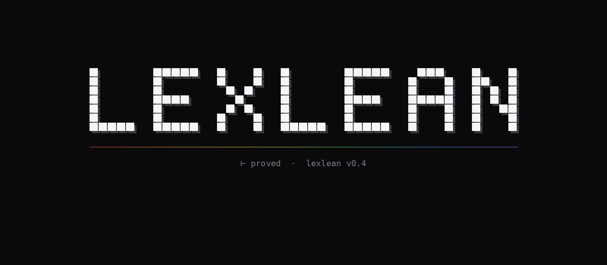

<div align="center">
  

  <p><strong>One controlled language in. A canonical paper, a kernel checked Lean 4 program, and a certified Rust package out.</strong></p>
</div>

LexLean compiles `.lex.tex` modules written in a closed controlled language. Every word, symbol, and control comes from a versioned lexicon package. Every sentence follows a fixed grammar. One typed representation produces both the canonical LaTeX document and a Lean 4 program with no prose.

`lexlean verify` compiles the generated Lean with `leanprover/lean4:v4.32.1`, replays every module with `leanchecker`, audits axioms by parsing `#print axioms` exactly, and publishes a content addressed attestation. `check` and `build` never claim verification.

[Spec](SPEC.md) · [Conformance](CONFORMANCE.md) · [Diagnostics](ERRORS.md) · [Evidence](VERIFICATION.md) · [Changelog](CHANGELOG.md) · [MNIST model](https://github.com/UOR-Foundation/MNIST)

## Quickstart

```text
docker pull ghcr.io/uor-foundation/lexlean:0.4.0
docker run --rm -v "$PWD:/work" ghcr.io/uor-foundation/lexlean:0.4.0 verify
```

The image is 4 GB because it carries the pinned toolchain. Each [release](https://github.com/UOR-Foundation/LexLean/releases) attaches one binary per supported host, the packaged crate, a CycloneDX bill of materials, checksums for every asset, and the gate evidence for the tagged commit.

```text
tar -xzf lexlean-0.4.0-binaries.tar.gz
sha256sum -c checksums.txt
```

A binary runs `init`, `lock`, `fmt`, `check`, and `build`. `verify` also needs the pinned toolchain through [elan](https://github.com/leanprover/elan). From source:

```text
cargo install --locked --path crates/lexlean
```

Then:

```text
lexlean init --name my-doc --module-prefix MyDoc
lexlean lock
lexlean check
lexlean build
lexlean verify
```

This is the complete SPEC.md §29 example, committed as [examples/nat-add-zero/src/Main.lex.tex](examples/nat-add-zero/src/Main.lex.tex):

```latex
\begin{lexlean}{Main}
\useglossary{lexlean.std.nat@1.0.0}
\title{Natural number addition}

\begin{theorem}{add-zero}
\noaxioms
For every natural number \(n\), \(n + 0 = n\).
\begin{proof}
Close the goal by reflexivity.
\end{proof}
\end{theorem}
\end{lexlean}
```

It generates a Lean module with no prose:

```lean
module
public import Init
set_option autoImplicit false
namespace LexLeanExample.Main

public theorem add_zero (llv0 : Nat) : Eq (Nat.add llv0 0) llv0 := by
  rfl

end LexLeanExample.Main
```

The same representation yields canonical LaTeX, source maps, coverage, and a manifest. Outputs are byte reproducible. `verify` checks the module, replays it with `leanchecker`, parses `#print axioms` exactly, and records the observed axiom set in a content addressed attestation.

## How it works

```text
document -> typed representation -> LaTeX + Lean 4 -> certified Rust
```

`lexlean init` scaffolds a project and claims nothing. `lock` pins lexicons and dependencies. `check` checks closure, grammar, typing, and diagnostics, never verification. `build` generates Lean, LaTeX, source maps, and manifests, never verification. `verify` compiles under the pinned toolchain, replays with `leanchecker`, audits axioms, and attests; it is the only verified claim. `production build` exports certified Rust packages. `migrate --to 1.2` upgrades a language 1.1 project in a scratch copy first and writes nothing on refusal.

A language 1.2 project can import a locked, content addressed package of its workspace. `[[source_package]]` in `lexlean.toml` names a member directory listed by `lexlean-workspace.toml`; `lexlean.lock` pins it by the digest of its manifest and source files. Every command recomputes the pin, imports stay closed, and `verify` replays the package's modules with the package as their origin (SPEC.md §10.5, `PK-01`..`PK-05`).

## Why LexLean

One linked representation feeds every output, so the paper and the program cannot drift. Every claim is a content addressed record: what was checked, with which toolchain, under which assumptions. Production compilation emits certificates that a consumer replays offline, without the source or a trusted producer.

Use it for safety critical code, audited or regulated artifacts, documents whose formal content must match their prose, and models or reasoners. The [MNIST model](https://github.com/UOR-Foundation/MNIST) is one: an int8 digit recognizer whose weights are content addressed artifacts and whose contract for every input is a theorem.

## Capabilities

Every capability is a claim in [`model/ids.toml`](model/ids.toml) at honesty level `build`. `just vv` validates every row by the test named `conformance_<id>`. See [CONFORMANCE.md](CONFORMANCE.md) for the full register.

Every directory under [examples/](examples/) must format, lock, check, build, and verify with Lean 4.32.1. Other suites cover arithmetic, logic, induction, recursion, collections, production, models, reasoning, fold laws, helpdesk, and uor atlas. [compiler/](compiler/), [stdlib/](stdlib/), and [bootstrap/](bootstrap/) are written in LexLean itself.

| Capability | IDs | Level |
| --- | --- | --- |
| Exact repository identity, layout, generated documents, release gate, total classification of every closed enum by every consumer, and the devcontainer pinned to the toolchains | `RP-01`..`RP-18` | `build` |
| Closed project configuration, canonical lock file, and offline dependency policy | `CF-01`..`CF-18` | `build` |
| Total lexical closure: every accepted atom is covered by exactly one declared origin | `LX-01`..`LX-14` | `build` |
| Versioned lexicon packages with closed schemas, denotations, and renderer tokens | `GL-01`..`GL-21` | `build` |
| Fixed structural, mathematical, and proposition grammar with closed ambiguity handling | `GR-01`..`GR-16` | `build` |
| Typed closed IR with canonical serialization, native core modules (and the second schema of them that lossless migration of the proof library needs), portable language-1.1 application data and operations, versioned language-1.2 semantic modules, products, first-class functions, and widening conversions, ordered collections and graphs, semantic snapshots, alpha identities, recursion evidence, a split on a document term or a Boolean in a proof, and content identities | `SM-01`..`SM-36` | `build` |
| Document and generic semantic declarations with exact self-application, type checking, structural recursion, recursive and mutual language-1.2 data, generic and executable higher-order definitions, mutual and well-founded recursion with semantic evidence, explicit state threading, and acyclicity rules | `DF-01`..`DF-18` | `build` |
| The structured proof language with pinned Lean lowerings, including closed linear arithmetic, integer order, and the fold laws | `PF-01`..`PF-23` | `build` |
| Prose-free deterministic generated Lean with complete token traceability | `LN-01`..`LN-12` | `build` |
| Canonical LaTeX regeneration and the optional hash-checked PDF provider | `TX-01`..`TX-12` | `build` |
| Canonical diagnostics, source maps, coverage, manifests, and reproducible builds | `AR-01`..`AR-14` | `build` |
| Sixteen-stage verification with leanchecker replay and exact axiom audit | `VR-01`..`VR-26` | `build` |
| The exact CLI contract, the stable seven-method Rust `Engine` API, the host-driven end of the children the library started, the `production` subcommands, and the `migrate` command | `CL-01`..`CL-25` | `build` |
| Filesystem confinement, no shell, no hidden network, closed failure model | `SE-01`..`SE-12` | `build` |
| The literal `nat-add-zero` example, the Lean-verified feature examples, and the complete negative fixture suite | `EX-01`..`EX-09` | `build` |
| Language-1.2 production eligibility: closed targets, effects, and construct dispositions; runtime closures; target-dependent, fail-closed root analysis; deterministic eligibility reports; an exhaustiveness audit; measured stack bounds for every recursive root a harness runs | `PD-01`..`PD-08` | `build` |
| Named-root extraction through Lean's compiler front end: an adapter that is a closed tooling module over a registry derived from the pinned Lean and probed on every extraction, checked against a handwritten oracle; a closed, canonical, root-independent compiler input; fail-closed rejection; and an exact closure cross-check against production eligibility | `NE-01`..`NE-06` | `build` |
| The production realization calculus: a closed target syntax with canonical identity, a kernel-checked denotation, a realization library agreeing with LexLean's own collection primitives, complete realization coverage of the production registry, and a differentially tested Rust profile | `TC-01`..`TC-07` | `build` |
| The canonical Rust backend: a closed, checked Rust AST whose every construct corresponds to the calculus; hygienic identifiers, single ownership with last-use and component moves, exact failure typing, and no hidden allocation; contiguous lists with constant-work cells; a closed runtime library boundary of stated machine primitives; deterministic packages with checked exports, a lint gate and crate attributes read from one embedded language module, and provenance that states the realization's effects | `RB-01`..`RB-21` | `build` |
| GNAF requests over the calculus: an optimizer-independent complete-system universe, a machine contract that accounts every action, scalar and Pareto orders without weighting, fail-closed validation, and kernel-checked answers and authority vectors | `GN-01`..`GN-08` | `build` |
| GNAF certification: certificates that prove a global optimum, an argmin, or a complete Pareto frontier over the request's declared universe (a grammar of systems, never all calculus or Rust programs) from a premise for every system, a library proving the checker sound, closed transformation schemas, local normality kept distinct from optimality, a bridge from a representation metric to execution cost, and honest non-global statuses | `GC-01`..`GC-11` | `build` |
| Semantic preservation from the source to the calculus: a validated lowering of every production root, a kernel-checked certificate per root relating the lowered program to the source denotation with exact width predicates, a differential evaluator, a proof library that is LexLean source (native core modules migrated once from the Lean it replaces, its Lean generated by the compiler) pinned by exact axioms, certificate checking in verification, a declared Rust machine on which every rendering is evaluated, certificate B relating every rendering to its program, certificate E composing them end to end on the declared Rust machine (the printer, export wrappers, and `rustc` are outside it and are measured by the rustc differential), boundary validators, a rustc differential of the declared machine, and certificates A and B as kernel-term data built by the production compiler, which carries no Lean text template | `SP-01`..`SP-29` | `build` |
| Language-1.2 models: content-addressed typed artifacts, contracts with sound validators, exact deterministic, rule, statistical, neural (integer kernels), and composite realizations, generated evidence obligations restated in Lean, checked runtime boundaries, and their identity, production, and verification | `MD-01`..`MD-13` | `build` |
| Language-1.2 reasoning machines: logics, guarded inference rules, verifiers, and forward, search, and generate-and-verify reasoners elaborated to ordinary declarations, with exact obligations, fixed-template theorems over the axiom-free reasoning runtime, a closed runtime boundary, resource ledgers, and their production and calculus realization, with GNAF requests over the clinical rule base's forward-chaining plans | `RS-01`..`RS-14` | `build` |
| The differential validation oracle: `lean4-prod` pinned by commit and content hash as validation evidence only, a corpus of every production root and one probe per runtime construct, a comparison of acceptance, contract, behavior, and resources that never compares bytes, versioned tables of known differences and of constructs outside the overlap, planted discrepancies detected, failures that are unavailable rather than validated, and its isolation from every identity | `OR-01`..`OR-08` | `build` |
| The production export contract: a stable, versioned `lexlean::api::production` façade and its CLI through which a consumer compiles production roots to certified Rust packages; closed requests refused before Lean on every root, target, pin, evidence, path, and package defect; results binding every output to the source, semantic, compiler-semantics, target, compiler-input, preservation, and certificate identities with unforgeable certification; deterministic, confined, offline bundles; source-free replay; versioned schemas; each output's effects and what `recursion` asks of the host | `PX-01`..`PX-13` | `build` |
| Language-1.2 compiler-tooling modules: a closed, typed program over a registry of the external Lean interface (types with exact constructors and index requirements, calls with exact signatures), with flat index-exhaustive matching, licensed partial and mutual recursion, complete recursive traversal, command registration, invocation and evaluation as semantic data, both backends from one linked value, and no member that holds Lean text | `TL-01`..`TL-11` | `build` |
| The language-1.2 authoring notation: a readable `.lex.tex` text for a semantic module, in bijection with its canonical JSON, whose every position and variant is read from the schema, with readable forms for types and terms and a generic form for every other value, formatted canonically by `fmt` failing closed, the only form in which a language-1.2 source of the product is written (the data form is refused under language 1.2, and `lexlean::sdk` is the explicit conversion), the same for the compiler-tooling modules in the generic notation, with no compiler-semantics ID that depends on which form an embedded module is written in, with no product source owned by a generator but five named records, read and written by programs only through the authoring API (`lexlean::sdk`), and, for a native core module, a readable program over the shared table of kernel terms whose numbering is the order of its text | `AU-01`..`AU-13` | `build` |
| The runtime of generated Lean as native modules: the portable, collection, model, and reasoning runtimes of language 1.2 are LexLean source that every generated module imports, migrated losslessly and audited against their exact axioms, the released runtime text of languages 1.0 and 1.1 is frozen data equal to their released output, and no other Lean runtime text remains in the compiler but the decoder of core module 2 | `RT-01`..`RT-04` | `build` |
| The standard library: language-1.2 source beside the compiler whose members are certified production roots, each validated against its oracle by a seeded differential of its evaluator and rustc realizations; bytes and text over `Bytes`, an output buffer of a given capacity written in order; SHA-256 against FIPS 180-4, the NIST CAVP vectors, and the `sha2` crate; and the `std-models` and `std-reasoning` source packages, generic over types, whose laws are kernel-checked theorems and whose application is the `helpdesk` example | `SL-01`..`SL-05` | `build` |
| The bootstrap project: the compiler's own components as language-1.2 source compiled by LexLean's production pipeline to certified Rust packages, the exact axiom-output parser and its closed Lean-name check, the primitive scanner of §12.2, the preservation lexer and token audit, the target calculus's checker, the Rust crate validator, and the Rust printer, each held to the Rust it replaces (the stage-0 oracle) by the committed vectors and a seeded differential of its evaluator and rustc realizations, with planted defects detected and the production export committed | `BS-01`..`BS-09` | `build` |
| Source packages: a language-1.2 project imports the modules of a locked, content-addressed package of its workspace: `[[source_package]]` and `lexlean-workspace.toml`, the pins in `lexlean.lock` recomputed by every command, imports closed at link, no re-export of a package's production roots, and the package's modules replayed by the importer's `verify` with their origin in the records | `PK-01`..`PK-05` | `build` |
| Language-1.2 text components, first slice: tokenizers and their round-trip laws, with the laws carried as one native core module the generated modules import rather than authored Lean text | `LM-01`..`LM-13` | `build` |
| Mathlib import, pinning: a language-1.2 project declares an external Lean library once, the lock pins it by exact revision, and only `lexlean deps fetch` acquires it; every other command stays offline | `ML-01`..`ML-05` | `build` |
| Mathlib import, replay cache: replayed declarations keyed by a content-addressed Merkle DAG of ADR-015 digest sets, with tampered or stale entries rejected | `RC-01`..`RC-06` | `build` |

## Gate

Prerequisites: Rust 1.97.1, [just](https://github.com/casey/just), `cargo-deny`, and Lean 4.32.1 through `elan`. The dev container provides all of them.

```text
just vv
just release
```

All 476 registered conformance IDs are implemented and pass. `just vv` runs the complete normative acceptance gate (SPEC.md §9.2). `just release` runs `vv` and the §30 criterion; it is refused until 1.0.0.

The [`lean4-prod`](https://github.com/UOR-Foundation/lean4-prod) differential is validation evidence only. A missing oracle fails on Linux x86 64 and prints `NOT VALIDATED` elsewhere. Releases live on `release/vX.Y`, and a tag before 1.0.0 does not claim the §30 criterion.

## Evidence

`check` and `build` never claim verification. Only `verify` runs Lean. Its attestation records toolchain hashes, process records, and observed axiom sets. External facts are `some-true` rows in [`model/ledger.toml`](model/ledger.toml). The gate is `just vv`; release waits for §30.

Generated Lean declares `public` declarations and imports where Lean 4.32.1 requires them. Unique existence lowers to its definitional expansion. Leading zeros are rejected, numerals are ascribed except at monomorphic constant binders, nested proof scopes use `quote`, names with `_` escape as `\_`, non ASCII surfaces need a renderer token, and unused binders get a `_` prefix. Fixtures are found by `case.toml`. Every deviation is enforced by the same gates.

## Layout

Language data is in [language/](language/), claims in [model/](model/), schemas in [schemas/](schemas/), the compiler in [crates/lexlean/](crates/lexlean/), and gates in [xtask/](xtask/) and [crates/conformance/](crates/conformance/). Examples are in [examples/](examples/) and negative fixtures in [tests/negative/](tests/negative/). CI is in [.github/](.github/).

## License

Dual licensed under [Apache 2.0](LICENSE-APACHE) or [MIT](LICENSE-MIT), at your option.
